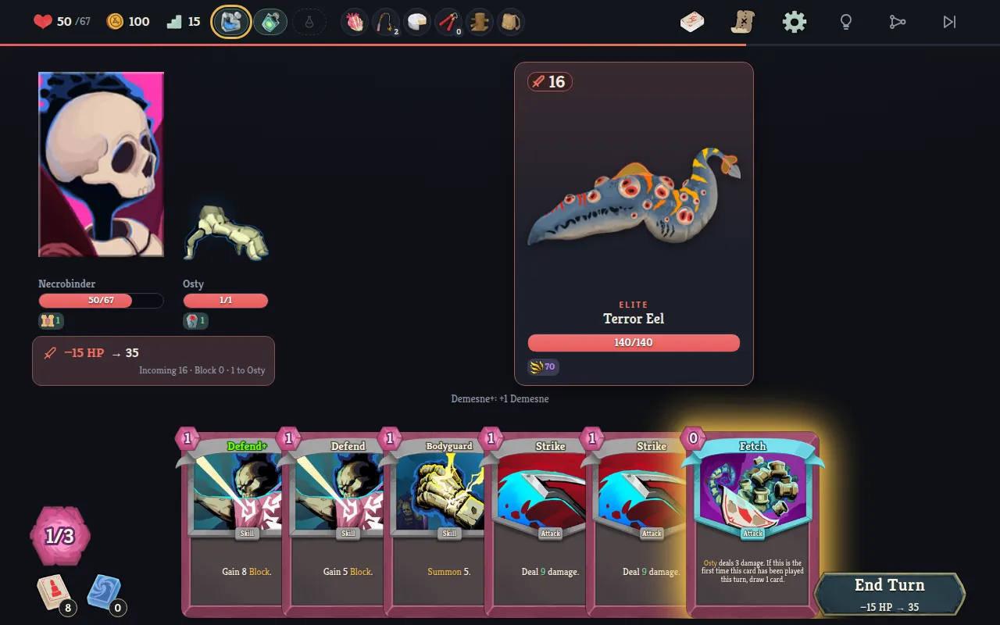

# SpireZero

A Slay the Spire 2 simulator written in Rust, a web client that plays it on a phone or a desktop,
and bots trained inside it.

The simulator follows the real game (v0.111.0) exactly: give it the same seed and the same moves
and you get the same run, down to every card drawn and every point of damage. All five characters
are in, through acts 1 to 3 and ascension 0 to 10.

Not affiliated with Mega Crit. You need your own copy of Slay the Spire 2 for art, audio, the
decompiled reference and the parity oracle; none of it is in this repo
([`PROVENANCE.md`](PROVENANCE.md) lists what is left out and why).



## Speed

Measured with `cargo xtask bench` on a Ryzen 7 7800X3D (8 cores, 16 threads), release build with
LTO. A fight is an Ironclad starter deck against one of the 22 act 1 encounters, played with
random legal moves until someone dies.

| | 1 core | 16 threads |
|---|---:|---:|
| fights per second | 115,000 | 1,000,000 |
| actions per second | 2.5 M | 22 M |
| time per action | ~400 ns | |
| whole runs per second (random play, ~70 actions each) | 11,400 | 114,000 |

```
cargo xtask bench --mode fights --threads 1
cargo xtask bench --mode fights --threads all --seeds 100000
cargo xtask bench --mode runs --threads 1 --runs 20000
```

A PGO build (`cargo xtask bench --pgo`) adds about 30% on one core. The state is plain data with
no pointers, so copying a fight for search is cheap and allocation-free once warm
(`crates/sts2-core/tests/it/copy_alloc.rs`). Profiles and the history of each speed-up are in
[`docs/perf.md`](docs/perf.md).

## Web client

`crates/sts2-web` is the game in the browser. The engine is compiled to wasm and runs in the page;
there is no game server, and saves and run history stay in local storage. There are two layouts
of the same client:

- Phone: one portrait column built for touch. Cards are tapped or dragged onto a target, the
  hand and End Turn sit at the thumb, sheets close with a swipe. It is sized for 390x664 (an
  iPhone 13 in Safari), tested in Chrome and WebKit, and installs to the home screen; over HTTPS
  it plays offline after the first load.
- Desktop: built for mouse and keyboard at 1440x900 to 1920x1080. Hover previews a card's
  upgrade and lights every map path through a room.

<p>


</p>

Every number on screen comes from the engine: a selected card shows the damage each enemy would
take and the HP that End Turn would cost after it. The map shows, per room type, the range over
every path to the boss. `realtest.sh` plays whole runs with real touch and mouse input and checks
the page against the engine's state after every action.

Two bots run in the browser, in a Web Worker with a wasm module of its own (`crates/sts2-web-bot`):

- The run bot from the next section. Hint lights its move with a one-line reason (a fight's
  win chance or a choice's confidence), and Watch the bot replays your seed with the bot
  playing and lists where you and it chose differently. It takes 31 ms per move at the median
  on a laptop, 360 ms at most in a boss fight.
- The Necrobinder combat net. "Net plays fights" lets it play every fight decision, each move
  lit and then played after a pause; "Net: one move" plays one. The browser gets the same
  observation bytes, masks and chosen actions as the training environment on 17,184 fight
  decisions (`crates/sts2-web-bot/tests/e2e_parity.rs`,
  [`docs/research/web83-net-findings.md`](docs/research/web83-net-findings.md)). The weights
  (29 MB) are not in the repo; without them the two buttons do not show.

`crates/sts2-web/export_static.sh` writes a release as a plain static tree for any static host.
Details in [`crates/sts2-web/README.md`](crates/sts2-web/README.md).

There is also a terminal client: `cargo run -p sts2-tui --release`
([`crates/sts2-tui/README.md`](crates/sts2-tui/README.md)).

## Bots

### Ironclad, whole runs

Ironclad, ascension 0. Every win is replayed in the engine to check it
([`docs/research/rlb14-playouts.md`](docs/research/rlb14-playouts.md)):

| seeds | wins |
|---|---|
| test, 9,000,000 x 200 | 187 (93.5%) |
| dev, 8,000,000 x 1,000 | 925 (92.5%) |
| train, 1,000,000 x 1,000 | 943 (94.3%) |

It never looks at the draw order, the RNG or how an event will roll; it only uses what a player
can see on screen ([`docs/specs/honesty.md`](docs/specs/honesty.md)). A test fails the build if
any of its choices depend on hidden state (`crates/sts2-diff/tests/it/honest.rs`).

Fights are played by a search over sampled worlds with a combat value net at the leaves. Map,
card reward, shop and rest choices come from a run policy trained with PPO. No human games were
used for any of it.

Most losses are at the act 3 boss: Queen and Test Subject account for 64 of 120 losses on the
train seeds ([`docs/research/rlb16-loss-anatomy.md`](docs/research/rlb16-loss-anatomy.md)).
[`docs/specs/a10-training.md`](docs/specs/a10-training.md) covers A10.

To reproduce the test row:

```
cargo build --release -p sts2-diff
target/release/sts2-diff bot --first 9000000 --count 200 \
    --value builtin --value-leaves --value-hp 300 --rollout v2 --value-mix 300 \
    --run-policy builtin --out DIR
```

### Necrobinder, fights only (in progress)

A separate combat-only net, trained with PPO on single fights; each fight is one episode. It sees
only the honest observation (`crates/sts2-rl/tests/leak.rs`). It is measured on a fixed panel of
1,067 boss and 1,091 elite fight starts taken from strong players' A10 runs (players with a
Necrobinder A10 win rate above 50%), against those players' own results:

| player | boss fights lost | elite fights lost |
|---|---:|---:|
| net, 1,255M decisions | 16.8% | 7.4% |
| net + 64-simulation MCTS | 14.2% | 5.9% |
| the human players | 7.5% | 2.9% |

Training is still running. The browser has the 759M checkpoint (17.3% / 7.8%).

## How parity is checked

`referee/` runs the real game headless. `sts2-diff` feeds the same moves to both and compares the
full state after every action: combat seeds, whole runs, events, ancients and maps, plus a set of
recorded runs kept as fixtures. On the run loadouts, 497 of 558 cards, all 64 potions and 231 of
242 powers have been exercised. Details in [`docs/regression.md`](docs/regression.md).

Behaviour comes from the game's decompiled code, which you generate locally with
`tools/decompile.sh` into `ref/` (git-ignored). Citations like `Foo.cs:123` in the code point there,
and [`docs/semantics/`](docs/semantics/) collects what has been learned from it.

## Building

```
cargo build --release
cargo xtask gate                 # fmt, clippy, tests
```

The web client:

```
rustup target add wasm32-unknown-unknown
cargo install wasm-bindgen-cli --version 0.2.129 --locked
cargo xtask art-import           # art and text from your copy of the game
crates/sts2-web/build.sh
crates/sts2-web/serve.sh         # port 8765, prints the LAN address and a QR code
```

Without the game you can build and test the whole workspace (tests that need game files skip),
run the engine, the RL environments and the benchmarks, use the TUI (it shows ids instead of
names), and build the web client.

With your copy (Steam, v0.111.0, found at the default install path, or set `STS2_GAME`):

| for | run |
|---|---|
| art and text in the TUI (`--features embedded`) and the web client | `cargo xtask art-import` |
| sound in the web client | `crates/sts2-web/tools/audio_import.py` |
| the decompiled reference in `ref/` | `tools/decompile.sh` (needs .NET and ilspycmd) |
| the referee and the differential tests | `referee/setup.sh` (also clones [sts2-cli](https://github.com/morefreeze/sts2-cli)) |

Imported data goes to `~/.cache/spirezero-data` (`$SPIREZERO_DATA`).

## Crates

| crate | |
|---|---|
| `sts2-core` | the engine: combat, the run, every card, relic, potion and monster |
| `sts2-macros` | proc macros for hook dispatch |
| `sts2-diff` | differential tests against the real game, and the run bot |
| `sts2-view` | screen models shared by both clients |
| `sts2-tui` | terminal client |
| `sts2-web`, `sts2-web-bot` | browser client, and the bots in Web Workers |
| `sts2-rl`, `sts2-ffi` | RL environments and their C ABI for Python |
| `sts2-bench`, `sts2-kernel` | benchmarks and an experimental fixed-size fight kernel |
| `referee/` | the real game, headless |
| `xtask/` | `cargo xtask gate`, `bench`, `art-import`, `coverage` |

Docs start at [`docs/README.md`](docs/README.md); [`docs/CHANGELOG.md`](docs/CHANGELOG.md) lists
changes, newest first.

## Contributing

Port behaviour from the decompiled code; don't guess it, and don't copy it. Fixtures and golden
data are read-only, so if a test fails, fix the engine. Game logic uses no floats (C# `decimal`
is emulated exactly).

## License

MIT, see `LICENSE`. `NOTICE` credits [spire-mentor](https://github.com/tfriedel/spire-mentor)
for adapted code and [sts2-cli](https://github.com/morefreeze/sts2-cli), which the referee builds
on.
