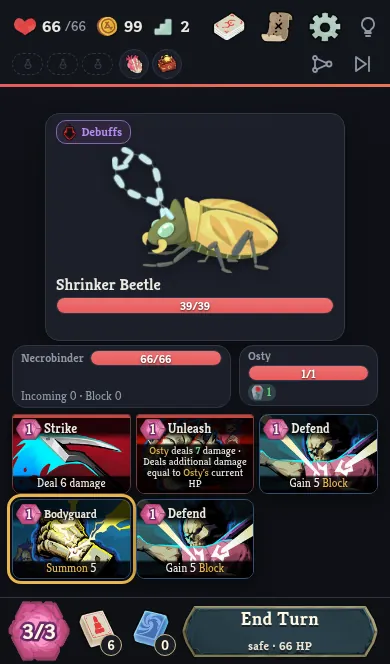
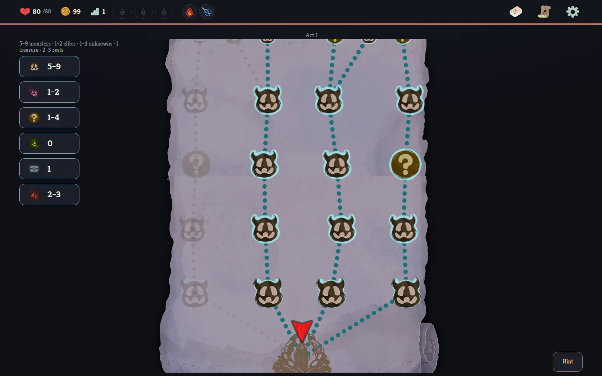

# SpireZero

[](https://github.com/ullnorse/spirezero/actions/workflows/ci.yml)

SpireZero is a Rust reimplementation of Slay the Spire 2 (v0.111.0) that matches the real game
step for step: the same seed and the same moves give the same run, down to every card drawn and
every point of damage. It is meant for two kinds of people: those who want a fast, exact simulator
to train or test bots on, and players who want the game on a phone or in a desktop browser with a
bot that can hint, play fights or replay their seed.

- The engine: all five characters, acts 1 to 3, ascension 0 to 10, about 1,000,000 random-play
  fights per second on an 8-core desktop.
- The parity check: the real game runs headless next to the engine and every action's full state is
  compared.
- A web client for phone and desktop, a terminal client, and bots trained only in the simulator.

You need your own copy of the game for art, sound and the parity oracle. The repo has none of the
game's art, audio, text or code, and this project is not affiliated with Mega Crit; see
[Game files](#game-files).


## The engine in numbers

| | |
|---|---|
| Content | 5 characters · 558 cards · 297 relics · 64 potions · 242 powers · 110 monsters · 87 encounters · 58 events · 8 ancients · 21 enchantments · 7 afflictions |
| Parity | last full sign-off (27 October 2026): 20 character/act cells x 200 runs, 0 divergences · 6,175/6,175 fights and 2,550/2,550 runs in the regression set · 3,000 recorded runs replayed with 0 engine mismatches |
| Speed, 1 core | 115,000 fights/s · 2.5M actions/s · ~400 ns per action · 11,400 whole runs/s |
| Speed, 16 threads | 1,000,000 fights/s · 22M actions/s · 114,000 whole runs/s |
| Training | Necrobinder combat PPO: ~15,600 decisions/s end to end on one GPU |
| Code | ~236k lines of Rust (143k of them the engine) · ~44k Python · ~8k JavaScript · 1,025 Rust `#[test]` functions · 301 Python tests |

The content counts are the entity files under `crates/sts2-core/src/content/`, one per card, relic
and so on; `cargo xtask coverage` prints what is ported per kind. The training figure is from
[`docs/research/rln44-fast-ppo.md`](docs/research/rln44-fast-ppo.md).

## Speed

Measured with `cargo xtask bench` on a Ryzen 7 7800X3D (8 cores, 16 threads), release build with
LTO. A fight is an Ironclad starter deck against one of the 22 act 1 encounters, played with
random legal moves until someone dies; a whole run of random play is about 70 actions.

```
cargo xtask bench --mode fights --threads 1
cargo xtask bench --mode fights --threads all --seeds 100000
cargo xtask bench --mode runs --threads 1 --runs 20000
```

A PGO build (`cargo xtask bench --pgo`) adds about 30% on one core. The state is plain data with
no pointers, so copying a fight for search is cheap and allocation-free once warm
(`crates/sts2-core/tests/it/copy_alloc.rs`). Profiles and the history of each speed-up are in
[`docs/perf.md`](docs/perf.md).

## Parity with the game

`referee/` runs the real game headless. `sts2-diff` feeds the same moves to both and compares the
full state after every action: combat seeds, whole runs, events, ancients and maps, plus a set of
recorded runs kept as fixtures. On the run loadouts, 497 of 558 cards, all 64 potions and 231 of
242 powers have been exercised. Details in [`docs/regression.md`](docs/regression.md).

Behaviour comes from the game's decompiled code, which you generate locally with
`tools/decompile.sh` into `ref/` (git-ignored). Citations like `Foo.cs:123` in the code point there,
and [`docs/semantics/`](docs/semantics/) collects what has been learned from it.

## Playing it

`crates/sts2-web` is the game in the browser. The engine is compiled to wasm and runs in the page;
there is no game server, and saves and run history stay in local storage. One client has two
layouts:

- Phone: one portrait column built for touch. Cards are tapped or dragged onto a target, the
  hand and End Turn sit at the thumb, sheets close with a swipe. It is sized for 390x664 (an
  iPhone 13 in Safari), tested in Chrome and WebKit, and installs to the home screen; over HTTPS
  it plays offline after the first load.
- Desktop: built for mouse and keyboard at 1440x900 to 1920x1080. Hover previews a card's
  upgrade and lights every map path through a room.

<p>


</p>

| | |
|---|---|
| Exact numbers | Every number on screen comes from the engine. A selected card shows the damage each enemy would take and the HP that End Turn would cost after it; the map shows, per room type, the range over every path to the boss. |
| Hint | The run bot lights its move with a one-line reason: a fight's win chance or a choice's confidence. 31 ms per move at the median on a laptop, 360 ms at most in a boss fight. |
| Watch the bot | After a run, the bot replays your seed and lists where you and it chose differently. |
| Net plays fights | The Necrobinder combat net plays every fight decision, each move lit and then played after a pause; "Net: one move" plays one. |
| Draw odds | The draw pile sheet gives the chance each card is in next turn's draw, from the pile's contents, never its order. |
| Practice | Practice runs get an Undo for the last card or potion of the turn, until something new is revealed. |
| History, Daily, Share | Every finished run is kept with its deck, relics and path; Daily plays a seed from the date; a seed link prefills the start screen. |

Both bots run in a Web Worker with a wasm module of their own (`crates/sts2-web-bot`). The browser
gets the same observation bytes, masks and chosen actions as the training environment on 17,184
fight decisions (`crates/sts2-web-bot/tests/e2e_parity.rs`,
[`docs/research/web83-net-findings.md`](docs/research/web83-net-findings.md)). The combat net's
weights (29 MB) are not in the repo; without them its two buttons do not show.

`realtest.sh` plays whole runs with real touch and mouse input and checks the page against the
engine's state after every action. `crates/sts2-web/export_static.sh` writes a release as a plain
static tree for any static host. Details in [`crates/sts2-web/README.md`](crates/sts2-web/README.md).

There is also a terminal client: `cargo run -p sts2-tui --release`
([`crates/sts2-tui/README.md`](crates/sts2-tui/README.md)).

## Bots

Both bots see only what a player sees on screen: never the draw order, the RNG or how an event will
roll ([`docs/specs/honesty.md`](docs/specs/honesty.md)).

### Ironclad, whole runs

Ascension 0. Every win is replayed in the engine to check it
([`docs/research/rlb14-playouts.md`](docs/research/rlb14-playouts.md)):

| seeds | wins |
|---|---|
| test, 9,000,000 x 200 | 187 (93.5%) |
| dev, 8,000,000 x 1,000 | 925 (92.5%) |
| train, 1,000,000 x 1,000 | 943 (94.3%) |

Fights are played by a search over sampled worlds with a combat value net at the leaves. Map,
card reward, shop and rest choices come from a run policy trained with PPO. No human games were
used for any of it. A test fails the build if any of its choices depend on hidden state
(`crates/sts2-diff/tests/it/honest.rs`).

Most losses are at the act 3 boss: Queen and Test Subject account for 64 of 120 losses on the
train seeds ([`docs/research/rlb16-loss-anatomy.md`](docs/research/rlb16-loss-anatomy.md)).
[`docs/specs/a10-training.md`](docs/specs/a10-training.md) covers A10.

To reproduce the test row:

```
cargo build --release -p sts2-diff
target/release/sts2-diff bot --first 9000000 --count 200 \
    --value builtin --value-leaves --value-hp 300 --rollout v2 --value-mix 300 \
    --run-policy builtin --out DIR
```

### Necrobinder, fights only (in progress)

A separate combat-only net, trained with PPO on single fights; each fight is one episode. Its
observation is checked for leaks by `crates/sts2-rl/tests/leak.rs`. It is measured on a fixed panel
of 1,067 boss and 1,091 elite fight starts taken from strong players' A10 runs (players with a
Necrobinder A10 win rate above 50%), against those players' own results:

| player | boss fights lost | elite fights lost |
|---|---:|---:|
| net, 1,255M decisions | 16.8% | 7.4% |
| net + 64-simulation MCTS | 14.2% | 5.9% |
| the human players | 7.5% | 2.9% |

Training is still running. The browser has the 759M checkpoint (17.3% / 7.8%).

## Where things are

| path | language | what it is |
|---|---|---|
| `crates/sts2-core` | Rust | the engine: combat, the run, every card, relic, potion and monster |
| `crates/sts2-macros` | Rust | proc macros for hook dispatch |
| `crates/sts2-diff` | Rust | differential tests against the real game, and the run bot |
| `crates/sts2-view` | Rust | screen models shared by both clients |
| `crates/sts2-tui` | Rust | terminal client |
| `crates/sts2-web`, `crates/sts2-web-bot` | Rust, JavaScript | browser client, and the bots in Web Workers |
| `crates/sts2-rl`, `crates/sts2-ffi` | Rust | RL environments and their C ABI |
| `crates/sts2-bench`, `crates/sts2-kernel` | Rust | benchmarks and an experimental fixed-size fight kernel |
| `referee/` | C# | the real game, headless |
| `python/` | Python | the `sts2` binding over the C ABI, training and evaluation scripts |
| `xtask/` | Rust | `cargo xtask gate`, `bench`, `art-import`, `coverage` |
| `fuzz/` | Rust | `cargo fuzz` targets, a workspace of their own |
| `tools/` | shell, Python | parity runs, coverage, decompiling |

Docs start at [`docs/README.md`](docs/README.md); [`docs/CHANGELOG.md`](docs/CHANGELOG.md) lists
changes, newest first.

## Building and testing

```
cargo build --release
cargo xtask gate                 # fmt, clippy, tests
```

Without the game you can build and test the whole workspace (tests that need game files skip),
run the engine, the RL environments and the benchmarks, use the TUI (it shows ids instead of
names), and build the web client. CI runs `cargo build` and `cargo test` on every push.

The web client:

```
rustup target add wasm32-unknown-unknown
cargo install wasm-bindgen-cli --version 0.2.129 --locked
cargo xtask art-import           # art and text from your copy of the game
crates/sts2-web/build.sh
crates/sts2-web/serve.sh         # port 8765, prints the LAN address and a QR code
```

With your copy (Steam, v0.111.0, found at the default install path, or set `STS2_GAME`):

| for | run |
|---|---|
| art and text in the TUI (`--features embedded`) and the web client | `cargo xtask art-import` |
| sound in the web client | `crates/sts2-web/tools/audio_import.py` |
| the decompiled reference in `ref/` | `tools/decompile.sh` (needs .NET and ilspycmd) |
| the referee and the differential tests | `referee/setup.sh` (also clones [sts2-cli](https://github.com/morefreeze/sts2-cli)) |

Imported data goes to `~/.cache/spirezero-data` (`$SPIREZERO_DATA`).

## Game files

Slay the Spire 2 is (c) Mega Crit; SpireZero is not affiliated with or endorsed by them. The repo
holds no art, audio, game text, assemblies or decompiled code. The tools above extract them from
your own install into git-ignored paths. The screenshots in `docs/img/` show our client with art
imported that way; no art file is in the repo. [`PROVENANCE.md`](PROVENANCE.md) lists what is left
out and why.

## Contributing

Port behaviour from the decompiled code; don't guess it, and don't copy it. Fixtures and golden
data are read-only, so if a test fails, fix the engine. Game logic uses no floats (C# `decimal`
is emulated exactly).

## Credits and license

MIT, see `LICENSE`. `NOTICE` lists the third-party code:
[spire-mentor](https://github.com/tfriedel/spire-mentor) (map pruning code adapted from it),
[sts2-cli](https://github.com/morefreeze/sts2-cli), which the referee builds on, and Godot's
`Mathf` API, which the referee re-implements.
